<div align="center">



<br/>


<br/>

[](https://github.com/menacing-aura/Conake-Browser/releases)
[](https://github.com/menacing-aura/Conake-Browser-Collab/stargazers)
[](https://github.com/menacing-aura/Conake-Browser-Collab/forks)
[](https://github.com/menacing-aura/Conake-Browser-Collab/issues)

<br/>


<br/><br/>

<a href="https://github.com/menacing-aura/Conake-Browser/releases"><kbd>　⬇ DOWNLOAD CONAKE　</kbd></a>
<a href="https://github.com/menacing-aura/Conake-Browser-Collab/issues"><kbd>　🎯 QUEST BOARD　</kbd></a>
<a href="https://discord.gg/BMcST6NaZS"><kbd>　💬 DISCORD　</kbd></a>
<a href="CONTRIBUTING.md"><kbd>　⚔ JOIN THE CREW　</kbd></a>

<br/><br/>

### 「 CONAKE://COLLAB-PORTAL 」

**An independent Chromium-powered browser with a custom ecosystem, custom identity, and room for new builders.**

</div>

---

> [!IMPORTANT]
> ### 🔐 PUBLIC PORTAL / PRIVATE CORE
> This repository is the **public collaboration hub** for Conake Browser.  
> The main application source is currently private. Contributors receive only the access needed for a scoped task.

---

## 🎴 QUICK SIGNAL

<table>
<tr>
<td width="25%" align="center">

### ⚡ ENGINE
**Chromium**

Fast modern web compatibility.

</td>
<td width="25%" align="center">

### 🧬 SHELL
**Electron**

Desktop-native browser UI.

</td>
<td width="25%" align="center">

### 🌐 NETWORK
**.conake**

Custom Conake names + services.

</td>
<td width="25%" align="center">

### ⚔ COLLAB
**OPEN**

Small missions first.

</td>
</tr>
</table>

<div align="center">

### TECH LOADOUT


</div>

---

# 🌌 ARC 01 // WHY CONAKE EXISTS

A browser can technically work and still feel soulless.

Conake is being built to explore what happens when the browser itself gets a stronger identity: custom workflows, custom pages, custom naming, customization, extension tooling, local profiles, optional AI experiments, and a UI that feels like **Conake**, not a recolored clone.

<table>
<tr>
<td width="50%" valign="top">

## ⚡ BROWSER CORE

- Chromium-powered browsing
- multi-tab navigation
- downloads
- bookmarks + favorites
- New Tab shortcuts
- address-bar navigation
- keyboard controls
- fullscreen workflows
- installer / release tooling

</td>
<td width="50%" valign="top">

## 🌙 CONAKE LAYER

- custom themes + wallpapers
- encrypted local profiles
- **.conake** names
- aliases such as **studio.conake**
- Conake Account
- extension-store work
- Snake Run
- custom setup flow
- experimental AI integrations

</td>
</tr>
</table>

### 🧠 The idea

```text
CHROMIUM
   │
   ▼
WEB COMPATIBILITY
   │
   ├──────────► EXTENSIONS
   │
   ├──────────► CONAKE UI
   │
   ├──────────► .CONAKE SERVICES
   │
   ├──────────► LOCAL PROFILES
   │
   └──────────► EXPERIMENTAL AI
                    │
                    ▼
              CONAKE BROWSER
```

> **The goal is not to hide Chromium. The goal is to build something distinct on top of it.**

---

# 🌀 ARC 02 // LIVE SYSTEM STATUS

<div align="center">

## **PUBLIC BUILD: v0.1.20**
### _Your first arc._

</div>

| SYSTEM | SIGNAL | CURRENT MODE |
|:--|:--:|:--|
| 🪟 **Windows** | 🟣 ONLINE | Public x64 installer |
| 🐧 **Linux** | 🟣 ONLINE | AppImage + Debian package |
| 🍎 **macOS** | 🟣 ONLINE | Intel + Apple Silicon |
| 💻 **Chromebook** | 🟡 PREVIEW | Dedicated preview build |
| 📱 **Android** | ⚫ LOCKED | Not officially supported yet |
| 🧪 **Regression tests** | 🟢 ACTIVE | Automated browser checks |
| 🧩 **Extensions** | 🟢 ACTIVE | Compatibility + store work |
| 🧠 **AI layer** | 🟡 EXPERIMENTAL | Local / hosted concepts |
| 🌐 **.conake** | 🟢 ACTIVE | Conake-native naming |

<div align="center">

[](https://github.com/menacing-aura/Conake-Browser/releases)
[](https://conake-domains.web-one1aura.workers.dev/setup)

</div>

---

# ✨ ARC 03 // FEATURE CONSTELLATION

<table>
<tr>
<td width="33%" align="center" valign="top">

## 🗂 FLOW

**Tabs**  
**Address bar**  
**Bookmarks**  
**Favorites**  
**Shortcuts**  
**Downloads**

_The everyday browsing layer._

</td>
<td width="33%" align="center" valign="top">

## 🎴 STYLE

**Themes**  
**Wallpapers**  
**New Tab UI**  
**Custom pages**  
**Conake identity**  
**Setup experience**

_Make the browser feel yours._

</td>
<td width="33%" align="center" valign="top">

## 🛡 CONTROL

**Site controls**  
**JavaScript controls**  
**Profiles**  
**Privacy work**  
**Developer tools**  
**Performance controls**

_More control, less mystery._

</td>
</tr>
</table>

<table>
<tr>
<td width="33%" align="center" valign="top">

## 🌐 NETWORK

**.conake names**  
**Conake Account**  
**Native aliases**  
**Custom services**

_A browser-native namespace._

</td>
<td width="33%" align="center" valign="top">

## 🧩 EXTENSIONS

**Chrome compatibility**  
**Conake Store**  
**Regression checks**  
**Compatibility fixes**

_Extend without reinventing everything._

</td>
<td width="33%" align="center" valign="top">

## 🤖 EXPERIMENTS

**Local AI**  
**Hosted AI**  
**Provider freedom**  
**Future browser tools**

_Optional experiments, not the whole identity._

</td>
</tr>
</table>

> [!TIP]
> Some features are stable. Some are experimental. Some are currently fighting the debugger in a badly lit alley.

---

# 🔥 ARC 04 // WHAT MAKES IT INTERESTING?

<table>
<tr>
<td width="50%" valign="top">

### 🪐 **Conake-native navigation**

Conake can experiment with browser-specific names like:

```text
studio.conake
```

instead of being limited to ordinary website UX.

</td>
<td width="50%" valign="top">

### 🎨 **Browser-first customization**

The browser itself is part of the product, including:

- themes
- wallpapers
- New Tab design
- shortcuts
- profile experience

</td>
</tr>
<tr>
<td width="50%" valign="top">

### 🧩 **Extension compatibility**

The project can build its own extension experience while still aiming for compatibility with the huge Chromium extension ecosystem.

</td>
<td width="50%" valign="top">

### ⚡ **Performance experiments**

Tab switching, memory visibility, UI responsiveness and lower-overhead workflows are active areas of development.

</td>
</tr>
</table>

---

# 🌠 ARC 05 // EVOLUTION MAP

<div align="center">

```text
                    ┌────────────────────┐
                    │  CONAKE BROWSER    │
                    │   NEXT EVOLUTION   │
                    └─────────┬──────────┘
                              │
          ┌───────────────────┼───────────────────┐
          │                   │                   │
          ▼                   ▼                   ▼
 ┌────────────────┐  ┌────────────────┐  ┌────────────────┐
 │  PERFORMANCE   │  │   ECOSYSTEM    │  │      UI        │
 ├────────────────┤  ├────────────────┤  ├────────────────┤
 │ faster tabs    │  │ .conake        │  │ smoother tabs  │
 │ memory tools   │  │ extensions     │  │ better setup   │
 │ lower overhead │  │ native pages   │  │ customization  │
 └───────┬────────┘  └───────┬────────┘  └───────┬────────┘
         │                    │                    │
         └────────────────────┴────────────────────┘
                              │
                              ▼
                    ┌────────────────────┐
                    │    SHIP + TEST     │
                    │    + ITERATE       │
                    └────────────────────┘
```

</div>

### Current directions

- ⚡ smoother tab switching
- 🧠 better memory visibility
- 🧩 stronger Chrome-extension compatibility
- ⭐ richer bookmark + favorites workflows
- 🛡 deeper site/privacy controls
- 💻 JavaScript toggles + developer tools
- 🌐 more Conake-native services
- 🐧 stronger Chromebook support
- 🔐 cleaner profile + account UX
- 🪐 deeper **.conake** navigation
- 🤖 provider-flexible AI experiments

---

# ⚔️ ARC 06 // COLLABORATOR CLASS SELECT

<div align="center">

## **COLLAB SIGNAL: OPEN**
### Looking for **1–2 builders**

</div>

<table>
<tr>
<td width="33%" align="center">

### ⚙️ CORE DEV
`JavaScript`  
`Node.js`  
`Electron`

**Difficulty:** ★★★☆☆

</td>
<td width="33%" align="center">

### 🌐 BROWSER DEV
`Chromium`  
`Browser APIs`  
`Extensions`

**Difficulty:** ★★★★☆

</td>
<td width="33%" align="center">

### 🎨 UI DEV
`HTML`  
`CSS`  
`UX`

**Difficulty:** ★★☆☆☆

</td>
</tr>
<tr>
<td width="33%" align="center">

### 🧪 TESTER
`Regression`  
`GitHub Actions`  
`Platform tests`

**Difficulty:** ★★☆☆☆

</td>
<td width="33%" align="center">

### 🧠 PERF DEV
`Profiling`  
`Memory`  
`Optimization`

**Difficulty:** ★★★★☆

</td>
<td width="33%" align="center">

### 🌱 LEARNER
`Git`  
`Small fixes`  
`Learning`

**Difficulty:** ★☆☆☆☆

</td>
</tr>
</table>

> [!NOTE]
> ### 💸 CURRENT COLLAB MODEL
> Conake currently has **no development budget**. Contributions are voluntary unless a separate written agreement explicitly says otherwise.

### Contributor rewards

- 🧬 Git commit attribution
- 🟩 contribution history
- 🏷 contributor recognition
- 🕒 flexible schedule
- 🎯 scoped tasks
- 🧠 input on product direction
- ⚡ room to take on larger work after successful missions

---

# 🎯 ARC 07 // QUEST BOARD

New collaborators do **not** get thrown into the entire browser codebase on day one.

Choose a small mission. Complete it. Review it. Level up.

| QUEST | TYPE | DIFFICULTY |
|:--|:--:|:--:|
| Smooth one tab/UI interaction | 🎨 UI | ⭐ |
| Reproduce a navigation bug | 🔧 Debug | ⭐ |
| Add a regression test | 🧪 QA | ⭐⭐ |
| Test a Chromebook build | 💻 Platform | ⭐⭐ |
| Check one extension | 🧩 Extensions | ⭐⭐ |
| Investigate tab memory | 🧠 Performance | ⭐⭐⭐ |
| Review focused Electron architecture | ⚙️ Core | ⭐⭐⭐ |

### Example branch names

```text
ui/new-tab-polish
fix/address-bar-navigation
perf/tab-switching
test/extensions-regression
feature/bookmark-search
platform/chromebook-check
```

<div align="center">

### QUEST FLOW

`PICK TASK` → `BRANCH` → `BUILD` → `TEST` → `PR` → `REVIEW` → `MERGE` → **LEVEL UP**

</div>

---

# 🧬 ARC 08 // CONTRIBUTOR PROGRESSION

```text
┌──────────────────┐
│  NEW CHALLENGER  │
└────────┬─────────┘
         ▼
┌──────────────────┐
│   SMALL MISSION  │
└────────┬─────────┘
         ▼
┌──────────────────┐
│   PULL REQUEST   │
└────────┬─────────┘
         ▼
┌──────────────────┐
│ REVIEW + TESTING │
└────────┬─────────┘
         ▼
┌──────────────────┐
│ TRUSTED BUILDER  │
└────────┬─────────┘
         ▼
┌──────────────────┐
│  BIGGER SYSTEMS  │
└──────────────────┘
```

The point is not gatekeeping. It keeps private-source access focused and prevents a tiny test task from becoming “here is the entire spaceship, good luck.” 💀

---

# 🔐 ARC 09 // PRIVATE SOURCE PROTOCOL

When a task needs source access:

1. Join using **your own GitHub account**.
2. Work on a dedicated branch.
3. Keep the change focused.
4. Run the relevant tests.
5. Open a pull request.
6. Explain what changed and how you tested it.
7. Wait for review before merge.

### 🚫 ZERO-CREDENTIAL RULE

Never request, send, screenshot, paste or commit:

`PASSWORDS` · `PAT TOKENS` · `API KEYS` · `SIGNING KEYS` · `CLOUDFLARE CREDENTIALS` · `PRIVATE LOGIN DATA`

> **If a workflow requires somebody else's password, the workflow is broken.**

---

# 📡 ARC 10 // SEND YOUR SIGNAL

To join, open an **Issue** and include:

- GitHub username
- languages / frameworks you know
- experience level
- relevant projects, if any
- browser / Electron / web / platform experience
- what type of Conake mission sounds interesting

<div align="center">

[](https://github.com/menacing-aura/Conake-Browser-Collab/issues)
[](https://discord.gg/BMcST6NaZS)
[](mailto:godscripters@gmail.com)
[](https://conake-studios.web-one1aura.workers.dev/)

</div>

---

# 🧪 ARC 11 // NEWCOMER BOOT SEQUENCE

<details>
<summary><b>01 // I only know HTML/CSS. Can I still help?</b></summary>

<br/>

Yes. UI polish, documentation, testing and small frontend work can be valid starter missions.

You do not need to understand Chromium internals to contribute something useful.

</details>

<details>
<summary><b>02 // Do I immediately get private source access?</b></summary>

<br/>

No. Access is given when a specific task requires it.

Starting with a small public discussion or isolated task keeps collaboration safer and easier for everyone.

</details>

<details>
<summary><b>03 // Is Conake open source?</b></summary>

<br/>

The public collaboration repository is open. The main browser source is currently private.

That may change over time, but this repository does not promise a future licensing model.

</details>

<details>
<summary><b>04 // Do I need to work fixed hours?</b></summary>

<br/>

No fixed hours. The important part is communicating clearly and finishing the scoped task you accept.

</details>

<details>
<summary><b>05 // Can beginners join?</b></summary>

<br/>

Yes, especially for testing, documentation, UI work or clearly scoped fixes.

Reliability beats pretending to know everything.

</details>

---

# 🧿 ARC 12 // CONAKE CODE

<div align="center">

```text
SHIP SMALL
    │
    ▼
TEST IT
    │
    ▼
REVIEW IT
    │
    ▼
MAKE IT BETTER
    │
    ▼
REPEAT
```

### **Small commits. Clear missions. No mystery blobs.**

</div>

Giant mystery commits turn browser projects into haunted architecture.

Small, reviewable changes keep Conake moving without detonating three unrelated systems because somebody renamed one button.

---

<div align="center">


<br/>

## 🐍 **CONAKE BROWSER**

**`CHROMIUM CORE`　×　`CONAKE SOUL`**

<br/>

[](https://github.com/menacing-aura/Conake-Browser/releases)
[](CONTRIBUTING.md)

<br/><br/>


</div>
